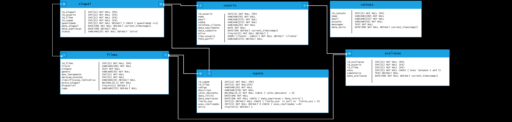

# Banco de dados — MovieFlix

Banco `movieflix` (MariaDB 10.4.32, charset `utf8mb4`, mecanismo InnoDB). Script de criação: `database/movieflix.sql`.

## DER

Como ler: `PK` é a chave primária, `FK` é a chave estrangeira e `UK` é um valor que não pode se repetir. Cada relacionamento liga o lado **1** ao lado **N**.

- Um **usuário** pode realizar vários **aluguéis** e várias **avaliações**.
- Um **filme** pode aparecer em vários **aluguéis** e receber várias **avaliações**.
- Um **filme** pode possuir vários **cupons**.
- Um **cupom** pode ser utilizado em vários **aluguéis**. Um aluguel pode utilizar um cupom ou nenhum.
- Cada **avaliação** pertence a um usuário e a um filme.
- A tabela `contato` não se relaciona com as demais: armazena as mensagens enviadas pelo formulário de contato.

## Resumo das tabelas

| Tabela | Para que serve |
|--------|----------------|
| `usuario` | Clientes e administradores cadastrados no site |
| `filmes` | Catálogo de filmes disponíveis para aluguel |
| `aluguel` | Registros dos aluguéis realizados pelos usuários |
| `cupons` | Cupons de desconto associados aos filmes |
| `avaliacao` | Notas e comentários dos usuários sobre os filmes |
| `contato` | Mensagens enviadas pelo formulário de contato |

## Dicionário de dados

### usuario

Armazena os dados das pessoas cadastradas no MovieFlix. O campo `tipo_usuario` diferencia clientes e administradores.

| Coluna | Tipo | Obrigatório | Chave | Descrição |
|--------|------|-------------|-------|-----------|
| `id_usuario` | INT, AUTO_INCREMENT | Sim | PK | Identificador único do usuário |
| `nome` | VARCHAR(50) | Sim | — | Nome do usuário |
| `email` | VARCHAR(255) | Sim | UK | E-mail utilizado para identificação e login |
| `senha` | VARCHAR(255) | Sim | — | Senha armazenada em formato de hash |
| `telefone_cliente` | VARCHAR(20) | Sim | — | Telefone de contato do usuário |
| `data_nascimento` | DATE | Sim | — | Data de nascimento do usuário |
| `data_cadastro` | DATETIME | Não | — | Data e hora do cadastro. Padrão: horário atual |
| `ativo` | TINYINT(1) | Sim | — | Indica se a conta está ativa. Padrão: `1` |
| `tipo_usuario` | ENUM('admin','cliente') | Sim | — | Tipo de usuário. Padrão: `'cliente'` |
| `foto_perfil` | VARCHAR(255) | Não | — | Caminho da imagem de perfil |

Observações:
- O e-mail possui restrição `UNIQUE`, impedindo cadastros com o mesmo endereço.
- O campo `tipo_usuario` diferencia administradores de clientes.
- A senha é armazenada em formato de hash, utilizando `password_hash()`.

### filmes

Armazena os dados dos filmes disponíveis no catálogo, como título, sinopse, gênero, ano de lançamento e preço do aluguel.

| Coluna | Tipo | Obrigatório | Chave | Descrição |
|--------|------|-------------|-------|-----------|
| `id_filme` | INT, AUTO_INCREMENT | Sim | PK | Identificador único do filme |
| `titulo` | VARCHAR(100) | Sim | — | Título do filme |
| `sinopse` | TEXT | Sim | — | Descrição da história do filme |
| `genero` | VARCHAR(50) | Sim | — | Gênero cinematográfico |
| `ano_lancamento` | INT | Sim | — | Ano de lançamento do filme |
| `duracao_minutos` | INT | Não | — | Duração do filme em minutos |
| `classificacao_indicativa` | VARCHAR(10) | Não | — | Classificação indicativa do filme |
| `preco_aluguel` | DECIMAL(6,2) | Sim | — | Valor cobrado pelo aluguel |
| `disponivel` | TINYINT(1) | Não | — | Indica se o filme está disponível. Padrão: `1` |
| `capa` | VARCHAR(255) | Não | — | Caminho da imagem de capa do filme |

### aluguel

Registra os aluguéis realizados pelos usuários, identificando o filme, o cliente, o cupom utilizado e as datas do aluguel.

| Coluna | Tipo | Obrigatório | Chave | Descrição |
|--------|------|-------------|-------|-----------|
| `id_aluguel` | INT, AUTO_INCREMENT | Sim | PK | Identificador único do aluguel |
| `id_usuario` | INT | Sim | FK → `usuario.id_usuario` | Usuário responsável pelo aluguel |
| `id_filme` | INT | Sim | FK → `filmes.id_filme` | Filme alugado |
| `id_cupom` | INT | Não | FK → `cupons.id_cupom` | Cupom utilizado. `NULL` quando não houver cupom |
| `quantidade` | INT | Sim | — | Quantidade de unidades alugadas. Padrão: `1`, mínimo: `1` |
| `data_aluguel` | DATETIME | Sim | — | Data e hora do aluguel. Padrão: horário atual |
| `data_expiracao` | DATETIME | Não | — | Data e hora de expiração do aluguel |
| `status` | VARCHAR(20) | Sim | — | Situação do aluguel. Padrão: `'ativo'` |

### cupons

Armazena os cupons de desconto disponibilizados no MovieFlix. Cada cupom está associado a um filme e possui código, valor de desconto e período de validade.

| Coluna | Tipo | Obrigatório | Chave | Descrição |
|--------|------|-------------|-------|-----------|
| `id_cupom` | INT, AUTO_INCREMENT | Sim | PK | Identificador único do cupom |
| `id_filme` | INT | Sim | FK → `filmes.id_filme` | Filme ao qual o cupom está associado |
| `codigo` | VARCHAR(30) | Sim | UK | Código utilizado para identificar o cupom |
| `descricao` | VARCHAR(150) | Sim | — | Descrição do desconto |
| `valor_desconto` | DECIMAL(6,2) | Sim | — | Valor do desconto. Deve ser maior que zero |
| `data_inicio` | DATETIME | Sim | — | Data e hora de início da validade |
| `data_expiracao` | DATETIME | Sim | — | Data e hora de encerramento da validade |
| `limite_uso` | INT | Não | — | Quantidade máxima de utilizações. `NULL` representa ausência de limite |
| `usos_realizados` | INT | Sim | — | Quantidade de vezes que o cupom foi utilizado. Padrão: `0` |
| `ativo` | TINYINT(1) | Não | — | Indica se o cupom está ativo. Padrão: `1` |

Observações:
- O código do cupom possui restrição `UNIQUE`, impedindo códigos repetidos.
- A data de expiração deve ser posterior à data de início.
- O limite de uso, quando informado, deve ser maior que zero.
- A quantidade de utilizações não pode ser negativa.

### avaliacao

Armazena as avaliações realizadas pelos usuários sobre os filmes, incluindo nota, comentário e data da avaliação.

| Coluna | Tipo | Obrigatório | Chave | Descrição |
|--------|------|-------------|-------|-----------|
| `id_avaliacao` | INT, AUTO_INCREMENT | Sim | PK | Identificador único da avaliação |
| `id_usuario` | INT | Sim | FK → `usuario.id_usuario` | Usuário que realizou a avaliação |
| `id_filme` | INT | Sim | FK → `filmes.id_filme` | Filme avaliado |
| `nota` | INT | Sim | — | Nota atribuída ao filme, entre 1 e 5 |
| `comentario` | TEXT | Não | — | Comentário escrito pelo usuário |
| `data_avaliacao` | DATETIME | Sim | — | Data e hora da avaliação. Padrão: horário atual |

Observações:
- A combinação de `id_usuario` e `id_filme` possui restrição `UNIQUE`. Assim, um usuário não pode cadastrar mais de uma avaliação para o mesmo filme.
- O campo `nota` possui uma restrição `CHECK` para aceitar somente valores entre 1 e 5.

### contato

Armazena as mensagens enviadas pelos visitantes por meio do formulário de contato do MovieFlix.

| Coluna | Tipo | Obrigatório | Chave | Descrição |
|--------|------|-------------|-------|-----------|
| `id_contato` | INT, AUTO_INCREMENT | Sim | PK | Identificador único da mensagem |
| `nome` | VARCHAR(100) | Sim | — | Nome de quem enviou a mensagem |
| `email` | VARCHAR(255) | Sim | — | E-mail para contato |
| `assunto` | VARCHAR(50) | Sim | — | Assunto da mensagem |
| `mensagem` | TEXT | Sim | — | Conteúdo da mensagem enviada |
| `data_envio` | DATETIME | Sim | — | Data e hora do envio. Padrão: horário atual |

## Restrições e integridade dos dados

O banco utiliza chaves primárias, chaves estrangeiras, índices e restrições para manter a organização e a integridade das informações.

| Restrição | Regra aplicada |
|-----------|----------------|
| `AUTO_INCREMENT` | Gera automaticamente os identificadores das tabelas |
| `UNIQUE` em `usuario.email` | Impede o cadastro de e-mails repetidos |
| `UNIQUE` em `cupons.codigo` | Impede códigos de cupom repetidos |
| `UNIQUE` em `avaliacao` | Impede que um usuário avalie o mesmo filme mais de uma vez |
| `CHECK` em `aluguel.quantidade` | A quantidade deve ser igual ou superior a 1 |
| `CHECK` em `avaliacao.nota` | A nota deve estar entre 1 e 5 |
| `CHECK` em `cupons.valor_desconto` | O desconto deve ser maior que zero |
| `CHECK` em `cupons.data_expiracao` | A expiração deve ser posterior à data de início |
| `CHECK` em `cupons.limite_uso` | O limite deve ser `NULL` ou maior que zero |
| `CHECK` em `cupons.usos_realizados` | A quantidade de utilizações não pode ser negativa |
| Chaves estrangeiras | Impedem referências a usuários, filmes e cupons inexistentes |

## Padrão de nomes

- Tabelas em letras minúsculas: `usuario`, `filmes`, `aluguel`.
- Colunas em `snake_case`: `id_usuario`, `data_aluguel`.
- Chaves primárias identificadas pelo prefixo `id_`.
- Chaves estrangeiras utilizando o identificador da tabela relacionada.
- Nomes sem acentos, espaços ou caracteres especiais.

## Tecnologias utilizadas

| Tecnologia | Utilização |
|------------|------------|
| MariaDB 10.4.32 | Sistema de gerenciamento do banco de dados |
| InnoDB | Mecanismo de armazenamento das tabelas |
| `utf8mb4` | Conjunto de caracteres utilizado para armazenar textos |
| phpMyAdmin 5.2.1 | Ferramenta utilizada para administrar e importar/exportar o banco |
| PHP 8.2.12 | Linguagem utilizada na aplicação para comunicação com o banco de dados |

## Arquivo SQL

O arquivo `database/movieflix.sql` contém a estrutura das seis tabelas, seus índices, chaves primárias, chaves estrangeiras, restrições e alguns registros iniciais de filmes e usuários.

Ele pode ser importado pelo phpMyAdmin para criar e configurar o banco de dados `movieflix`.