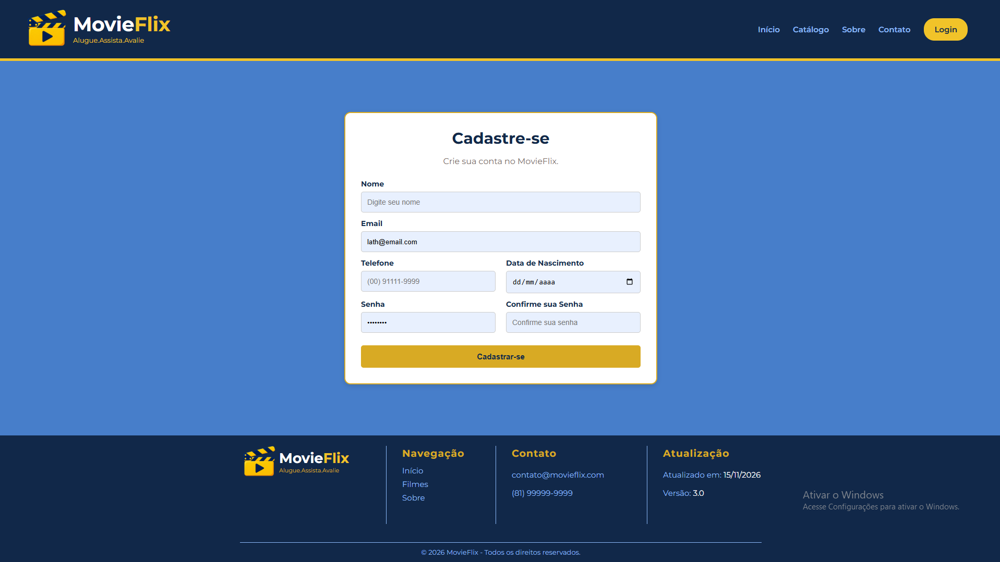
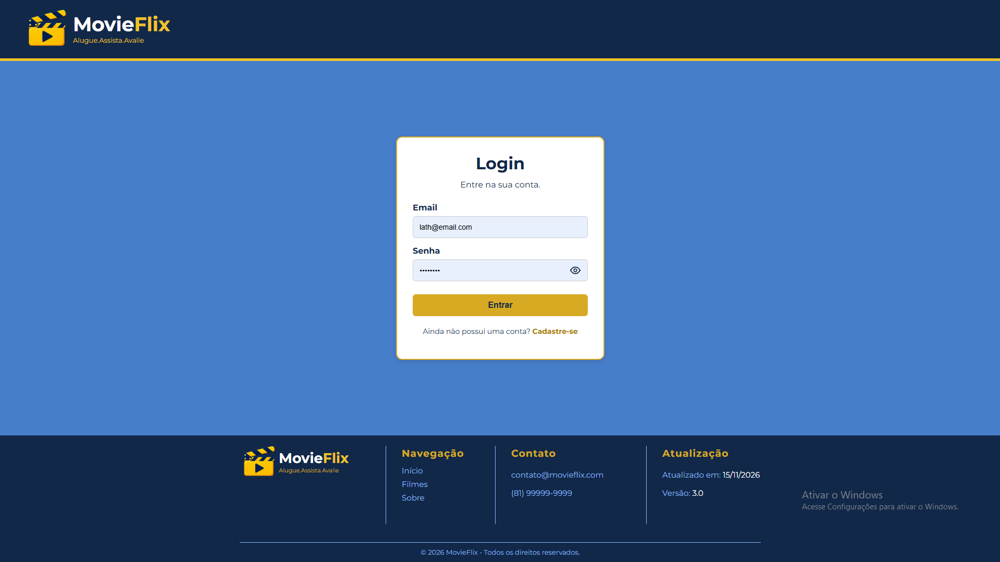
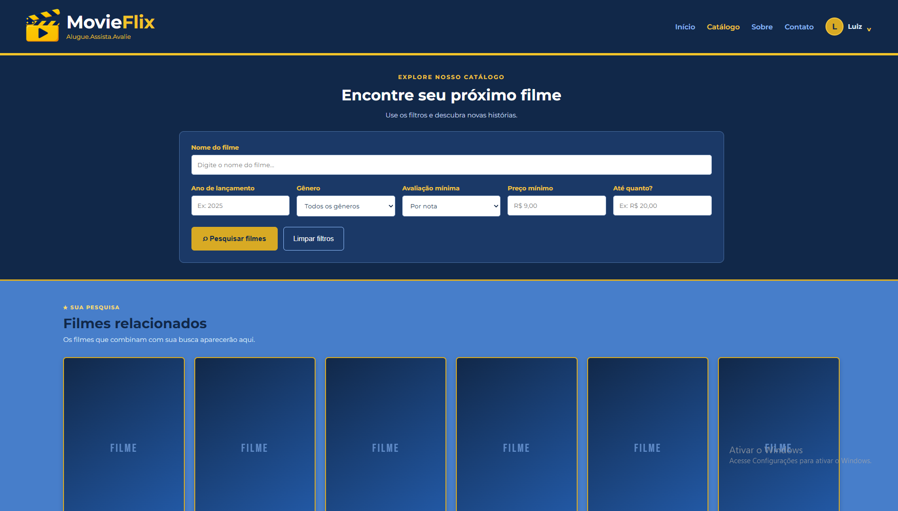
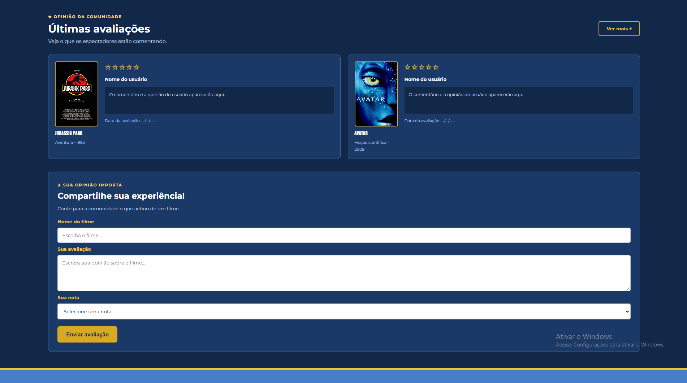
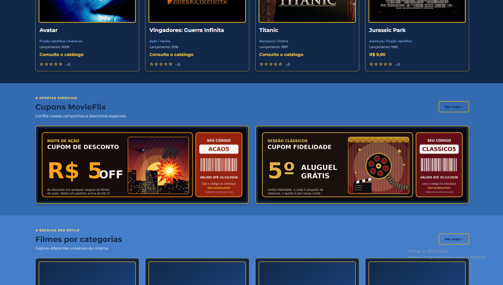
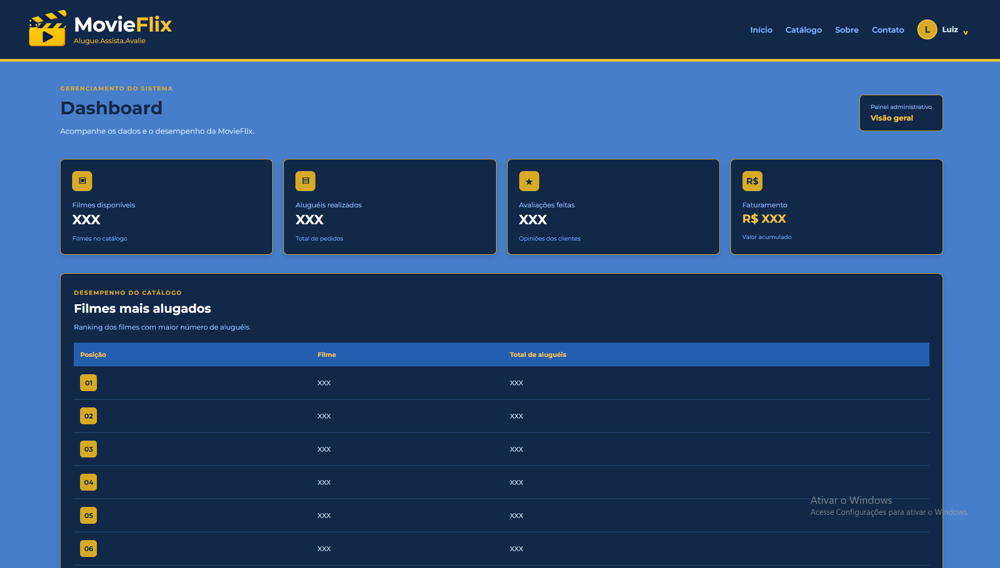

# Manual do Usuário — MovieFlix

## 1. Apresentação

O MovieFlix é um sistema de aluguel de filmes que permite aos usuários criar uma conta, acessar o catálogo, consultar informações dos filmes, realizar aluguéis e publicar avaliações.

O sistema possui dois tipos de usuários:

- **Cliente:** pode acessar o catálogo, realizar aluguéis, utilizar cupons disponíveis, avaliar filmes e consultar seu perfil.
- **Administrador:** possui acesso às funcionalidades administrativas, podendo gerenciar o catálogo e acompanhar informações do sistema.

Este manual apresenta as principais funcionalidades do MovieFlix e explica como utilizá-las.

---

## 2. Como criar uma conta

Para utilizar as funcionalidades de cliente, é necessário realizar um cadastro no MovieFlix.

1. Acesse a página inicial do MovieFlix.
2. Clique no botão **Login**.
3. Na página de login, procure a opção de cadastro de uma nova conta.
4. Clique em **Cadastre-se** ou na opção correspondente.
5. Preencha os campos solicitados:
   - Nome completo;
   - E-mail;
   - Telefone;
   - Data de nascimento;
   - Senha;
   - Confirmação de senha.
6. Confira as informações preenchidas.
7. Clique no botão **Cadastrar**.

Após a conclusão do cadastro, a conta será registrada como cliente e poderá ser utilizada para acessar o sistema.

**Imagem ilustrativa:**

---

## 3. Como realizar login

O login permite acessar uma conta já cadastrada no MovieFlix.

1. Acesse a página inicial do MovieFlix.
2. Clique no botão **Login**.
3. Informe seu e-mail cadastrado.
4. Informe sua senha.
5. Clique no botão **Entrar**.

Após a autenticação, você será direcionado para a página correspondente ao seu tipo de usuário.

**Imagem ilustrativa:**

---

## 4. Como encontrar e consultar filmes

O catálogo permite visualizar os filmes disponíveis para aluguel e consultar suas informações.

1. Acesse a página inicial do MovieFlix.
2. Clique em **Catálogo** no menu de navegação.
3. Navegue pelas seções de filmes disponíveis.
4. Utilize os campos de pesquisa e filtros, quando disponíveis, para localizar um filme.
5. Consulte as informações apresentadas, como:
   - Título;
   - Sinopse;
   - Gênero;
   - Ano de lançamento;
   - Classificação indicativa;
   - Nota e avaliações;
   - Preço do aluguel.

Dessa forma, é possível conhecer os filmes disponíveis antes de escolher qual deseja alugar.

**Imagem ilustrativa:**

---

## 5. Como realizar um aluguel

Para alugar um filme, é necessário possuir uma conta e estar autenticado no sistema.

1. Realize o login com sua conta.
2. Acesse o **Catálogo**.
3. Escolha o filme desejado.
4. Consulte as informações e o preço do aluguel.
5. Clique na opção **Alugar**, quando disponível.
6. Confira as informações do aluguel.
7. Caso deseje, informe um cupom de desconto válido.
8. Confirme a operação, seguindo as instruções apresentadas pelo sistema.

Após a confirmação, o aluguel será registrado e poderá ser consultado na área destinada aos aluguéis do usuário.

**Imagem ilustrativa:**

**EM PRODUÇÃO**

## 6. Como avaliar um filme

O MovieFlix permite que os usuários registrem suas opiniões sobre os filmes.

1. Realize o login na sua conta.
2. Acesse o catálogo ou a área de avaliações.
3. Escolha o filme que deseja avaliar.
4. Selecione uma nota de 1 a 5 estrelas.
5. Escreva um comentário sobre o filme, caso deseje.
6. Clique no botão **Enviar avaliação** ou na opção correspondente.

Após o envio, a avaliação será registrada e poderá aparecer na área de avaliações do MovieFlix.

Cada usuário pode cadastrar apenas uma avaliação por filme.

**Imagem ilustrativa:**

## 7. Como utilizar um cupom de desconto

Os cupons permitem obter descontos em determinados aluguéis, de acordo com as condições estabelecidas.

1. Acesse o catálogo do MovieFlix.
2. Consulte os cupons disponíveis.
3. Escolha um filme relacionado ao cupom desejado.
4. Inicie o processo de aluguel.
5. Localize o campo destinado ao código do cupom.
6. Informe o código correspondente.
7. Confirme a aplicação do cupom.
8. Confira o desconto apresentado antes de finalizar o aluguel.

**Importante:** o cupom precisa estar ativo, dentro do período de validade e respeitar seu limite de utilização, quando houver.

**Imagem ilustrativa:**

## 8. Como acessar o perfil

O perfil permite consultar as informações da conta utilizada no MovieFlix.

1. Realize o login.
2. Localize o menu de perfil na barra de navegação.
3. Clique no menu para visualizar as opções disponíveis.
4. Selecione **Meu perfil**.
5. Consulte as informações cadastradas, como nome, e-mail, telefone e foto de perfil.
6. Utilize as opções disponíveis na página para realizar alterações, quando permitidas.

O perfil também permite acessar outras funcionalidades relacionadas à conta, conforme o tipo de usuário.

**Imagem ilustrativa:**

---

## 9. Como administrar o catálogo (administrador)

O administrador possui acesso às funcionalidades responsáveis pelo gerenciamento do MovieFlix.

1. Acesse a página de login.
2. Informe as credenciais de uma conta com permissão de administrador.
3. Após a autenticação, acesse o menu do perfil.
4. Clique em **Dashboard** para visualizar as informações administrativas.
5. Utilize as opções disponíveis para acessar o gerenciamento de filmes.
6. Na área de filmes, consulte o catálogo cadastrado e utilize as opções de gerenciamento disponíveis.
7. Realize as operações permitidas, como cadastrar, editar ou remover filmes, conforme as funcionalidades implementadas no sistema.

O acesso às funcionalidades administrativas é restrito aos usuários com o tipo de conta **admin**.

**Imagem ilustrativa:**

## 10. Perguntas Frequentes (FAQ)

### Como recuperar minha senha?

Caso tenha esquecido sua senha, verifique se a página de login disponibiliza uma opção de recuperação de senha. Se essa funcionalidade não estiver disponível, será necessário entrar em contato com o responsável pelo sistema para solicitar suporte.

### Como faço para encontrar um filme?

Acesse a opção **Catálogo** no menu principal. Nessa página, você poderá navegar pelos filmes e utilizar os recursos de pesquisa e filtros disponíveis.

### Como acesso minha conta?

Clique em **Login**, informe seu e-mail e sua senha cadastrados e selecione **Entrar**. Após a autenticação, você terá acesso às funcionalidades correspondentes ao seu tipo de usuário.

### Qual a diferença entre administrador e cliente?

O cliente utiliza as funcionalidades comuns do sistema, como consultar filmes, realizar aluguéis e avaliações.

O administrador possui permissões adicionais para acessar o painel administrativo e gerenciar informações do sistema.

### Posso avaliar o mesmo filme várias vezes?

Não. Cada usuário pode realizar apenas uma avaliação por filme.

### Posso utilizar qualquer cupom em qualquer filme?

Não necessariamente. Alguns cupons estão vinculados a filmes específicos e possuem condições de validade e utilização.

### Preciso estar conectado para realizar um aluguel?

Sim. É necessário realizar login para que o sistema identifique o usuário responsável pelo aluguel.

## 11. Considerações finais

Este manual foi elaborado para orientar os usuários na utilização das principais funcionalidades do MovieFlix.

Por meio dele, é possível compreender como criar uma conta, acessar o sistema, consultar filmes, realizar aluguéis, enviar avaliações e utilizar as funcionalidades administrativas.

Em caso de dúvidas ou dificuldades durante a utilização, recomenda-se entrar em contato com o responsável pelo sistema.